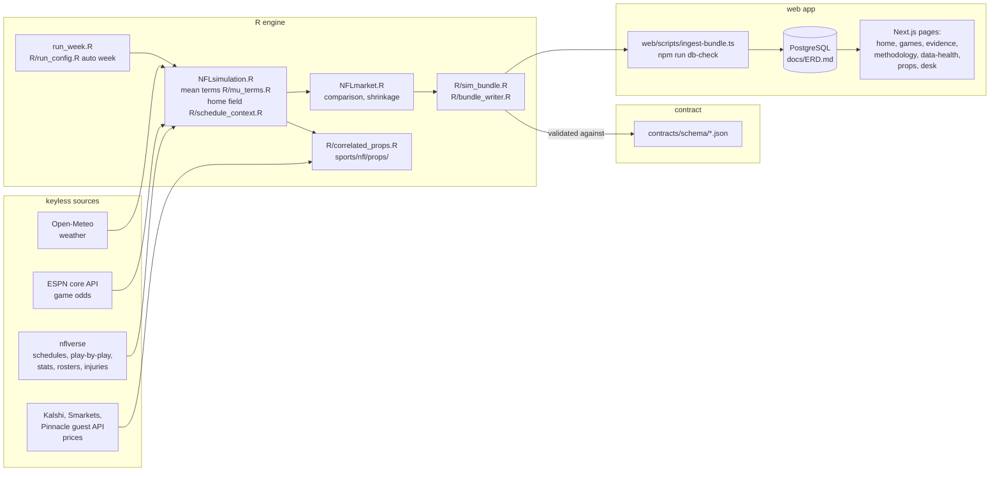

# Architecture

How the system fits together, from data sources to the pages the app serves. The database tables and their keys are in `docs/ERD.md`. What each model number rests on is in `docs/EVIDENCE_LEDGER.md` and the dated `reports/`. Model claims are made only there.

**Verified against the code on 2026-11-05** (main after #235–#237). This replaces the January 2026 version, which described removed scripts and withdrawn validation figures.

## The lineage: sources to pages



**Audit tables beside the bundle:** `artifacts/baseline_games.csv` and `artifacts/baseline_props.csv`, and the run logs `run_logs/config_*.rds`, `run_logs/final_*.rds` and `run_logs/mu_terms_*.rds`.

## The game model

| Step | Where | What it does now |
|---|---|---|
| Week and season | `run_week.R`, `R/run_config.R`, `R/date_resolver.R` | Resolves the upcoming week from the nflverse schedule, or takes `<week> <season>` |
| Schedules | `load_schedules_checked()` (`R/schedule_context.R`) | Downloads again after a failed download, then stops with nflreadr's warning |
| Injuries | `safe_load_injuries()` | Retries seasons with games, and flags a missing season "partial" with its cause |
| Home field | `hfa_table_asof()` (`R/schedule_context.R`) | Regular-season results before the slate's week, from the last ten seasons. `HFA_TEAM_ESTIMATOR` (`config.R`) chooses one league value or per-team values |
| Mean scores | `compose_mu()` (`R/mu_terms.R`) | Sums the admitted terms, `MU_TERMS_ADMITTED` = drives × points per drive, plus home field. The other 13 terms are computed and logged (`run_logs/mu_terms_*.rds`), not simulated (audit M22) |
| Scores | `simulate_game_nb()` | Negative binomial scores joined by a Gaussian copula, `N_TRIALS` draws per game |
| Calibration backtest | `week_inputs_and_sim_2w()` | Simulates past weeks with the same admitted terms and home field as of each cut. It trains the blend below |
| Published probability (C3) | NFLsimulation.R, then `sb_predictions()` in `R/sim_bundle.R` | The raw simulator probability goes through a ridge blend with the no-vig market and an isotonic map, then is shrunk 70% toward the market (`SHRINKAGE`). The spline and isotonic calibrators are printed as diagnostics only (audit M4) |
| Market comparison and staking | `NFLmarket.R` | EV, edge quality, 1/8 Kelly (`KELLY_FRACTION`) with caps. A game with no line has no edge |

## Player props

| Step | Where |
|---|---|
| Projections | `sports/nfl/props/data_sources.R` (point in time, week-filtered) |
| Simulation, one module per stat | `sports/nfl/props/{passing_yards,rushing_yards,receiving_yards,receptions,touchdowns}.R`, correlated with the game draws (`R/correlated_props.R`) |
| Market quotes | `R/prop_odds_api.R`: a point-in-time quote cache, `get_market_prop_quotes()` (stale after `PROP_QUOTE_MAX_AGE_MIN`) |
| The signed test | `nfl_props_v1` runs a frozen copy of this module (`4c1c377`) on 2026 weeks 9–18 (`backtest/eval_windows/nfl_props_v1.json`) |

The database already has prop tables (`prop_projections`, `prop_line_probs`), but no bundle kind carries props yet. The props design (PR #238) covers that work.

## The contract and the app

- **The contract:** `contracts/schema/` defines each bundle file.
  - `bundle_kinds.json` names two kinds. **weekly** requires teams, games, game_predictions and source_status. **backtest** carries eval windows, runs, metrics, calibration bins, promotion gates and the evidence ledger.
  - `R/bundle_writer.R` validates on the R side, and the ingest validates again.
- **Ingest:** `web/scripts/ingest-bundle.ts` loads a bundle into PostgreSQL. A bundle that fails QA is stored as `qa_failed`, and the app keeps the last good run.
  - `npm run db-check` (`web/src/lib/dbcheck/checks.ts`) runs the SQL data checks after every ingest.
  - The append-only and CHECK invariants are in `web/drizzle/0001_invariants.sql`.
- **Pages:** `web/src/app/` serves home, `games/[id]`, evidence, methodology, data-health, props, desk (sign-in) and login.
- **Offline:** `npm run local` (`web/scripts/local.ts`) starts a local PostgreSQL, ingests the newest local bundle and serves the app at http://127.0.0.1:3000.

## Validation and backtests

| Area | Where |
|---|---|
| Pre-registered game backtest | `backtest/walk_forward.R`; the signed windows are in `backtest/eval_windows/` |
| Validation framework (S0–S5) | `backtest/vvf/` |
| Pre-close protocol | `backtest/preclose/` (`nfl_preclose_v1`, signed) |
| Point-in-time inputs | `backtest/build_inputs.R` and `backtest/data/` |
| Odds layer (keyless) | `R/odds/`: `http.R` (1 request a second per domain, no workaround for a block), providers for nflverse, ESPN core and Kalshi, snapshots, the closing rule, the archive |

## Operations

| Job | Where | When |
|---|---|---|
| Weekly simulation | `.github/workflows/weekly-sim.yml` | Tuesday 18:00Z and Friday 21:00Z |
| Odds captures and archive | `odds-capture.yml`, `capture-archive.yml` | Weekly schedules (crons in the files) |
| CI | `ci.yml` (R syntax, smoke, audit), `ci-web.yml` (web), `golden-master.yml` (2024 week 15, every commit attributed) | Pull requests into main |
| Prospective tests | A private dispatcher (`prospective_dispatch.R` on a Windows scheduled task) | Every 15 minutes, weeks 9–18 |

## Directory map

```
run_week.R  config.R  NFLsimulation.R  NFLmarket.R  NFLbrier_logloss.R  injury_scalp.R
R/                 engine modules (utils, data_validation, logging, schedule_context, mu_terms,
                   sim_bundle, bundle_writer, correlated_props, prop_odds_api, odds/ ...)
sports/nfl/props/  prop data sources and one simulation module per stat
backtest/          walk-forward, vvf/, preclose/, eval_windows/, data/
contracts/         schema/ (the bundle contract) and fixtures/
web/               Next.js app, Drizzle schema (src/db/schema.ts), migrations (drizzle/), scripts/
scripts/           run_tests.R, verify_repo_integrity.R, run_matrix.R, golden_master.R, ...
reports/           dated evidence: protocols, results, attributions, research
docs/              this file, ERD.md, modeling.md, API.md, odds-sources.md, ledgers, specs, plans
tests/testthat/    the R test suite (run with scripts/run_tests.R)
```
