# Data model (ERD)

Generated by `npm run erd` from `web/src/db/schema.ts`; do not edit by hand (`npm run erd` rewrites it and `web/src/lib/erd.test.ts` fails when it is stale). It is the column list the 2026-09-28 design spec (§3) promised as `docs/data-contract.md`. The invariants SQL enforces are in `web/drizzle/0001_invariants.sql`; the checks run after every ingest are `npm run db-check` (`web/src/lib/dbcheck/checks.ts`).

Keys: PK primary key, FK foreign key, UK unique. A relationship drawn `|o--o{` has a nullable foreign key.

```mermaid
erDiagram
  auth_throttle {
    text key PK
    integer failures
    timestamptz window_start
    timestamptz locked_until
  }
  backtest_metrics {
    text bt_run_id PK, FK
    text split PK
    text phase PK
    text candidate PK
    integer n
    float8 brier
    float8 logloss
    float8 accuracy
    float8 ece
    float8 slope
    float8 slope_lo
    float8 slope_hi
    float8 skill
    float8 skill_lo
    float8 skill_hi
    float8 dm_p_better_bh
  }
  backtest_runs {
    text bt_run_id PK
    text window_id FK
    text run_id FK
    text status
    text result_sha256
    text code_git_sha
    timestamptz generated_utc
    jsonb controls
    jsonb clv_summary
  }
  bet_grades {
    text run_id PK, FK
    text rec_id PK, FK
    text grader_version PK
    text outcome
    float8 clv_bps
    float8 units
  }
  bundle_ingests {
    text bundle_sha256 PK
    text cycle_id
    text kind
    text run_id
    text status
    timestamptz ingested_at
  }
  calibration_bins {
    text bt_run_id PK, FK
    text split PK
    text candidate PK
    integer bin PK
    float8 p_mean
    float8 y_mean
    integer n
  }
  closing_lines {
    text game_id PK, FK
    text market_id PK, FK
    text venue_id PK, FK
    text player_key PK
    text side PK
    integer snapshot_id FK
    float8 close_gap_min
    text rule_version
  }
  clv_picks {
    text bt_run_id PK, FK
    text candidate PK
    text game_id PK, FK
    text side
    float8 clv_bps
    float8 units
  }
  eval_windows {
    text window_id PK
    jsonb folds
    text protocol_sha256
    timestamptz frozen_at_utc
  }
  evidence_ledger {
    text claim_id PK
    text claim
    text status
    text reason
    text evidence_path
    text supersedes
  }
  game_predictions {
    text run_id PK, FK
    text game_id PK, FK
    text candidate PK
    float8 p_home_raw
    float8 p_home_final
    float8 p_home_mkt_novig
    float8 margin_q50
    float8 total_q50
  }
  games {
    text game_id PK
    integer season
    integer week
    text game_type
    text home_team_id FK
    text away_team_id FK
    timestamptz kickoff_utc
    text roof
    boolean neutral
    integer home_score
    integer away_score
  }
  markets {
    text market_id PK
    text scope
    text outcome_kind
    text grading_rule
  }
  model_runs {
    text run_id PK
    text kind
    text cycle_id
    integer season
    integer week
    text model_label
    text code_git_sha
    boolean code_dirty
    text config_hash
    jsonb config
    integer seed
    integer n_sims
    text bundle_sha256 UK
    timestamptz generated_utc
    timestamptz data_asof_utc
    boolean qa_ok
    jsonb qa_failures
    text status
  }
  odds_snapshots {
    bigserial snapshot_id PK
    integer fetch_id FK
    text game_id FK
    text market_id FK
    text venue_id FK
    text player_id FK
    text side
    numeric line
    integer price_american
    numeric bid
    numeric ask
    numeric last
    numeric volume
    timestamptz captured_at
  }
  player_aliases {
    text source PK
    text alias PK
    text player_id FK
  }
  player_game_stats {
    text game_id PK, FK
    text player_id PK, FK
    text stat PK
    float8 value
  }
  players {
    text player_id PK
    text full_name
    text position
  }
  promotion_gates {
    text bt_run_id PK, FK
    text candidate PK
    boolean g1
    boolean g2
    boolean g3
    boolean g4
    text brier_status
    text betting_value_status
  }
  prop_line_probs {
    text run_id PK, FK
    text player_id PK, FK
    text market_id PK, FK
    numeric line PK
    float8 p_over
    float8 p_push
  }
  prop_projections {
    text run_id PK, FK
    text game_id PK, FK
    text player_id PK, FK
    text market_id PK, FK
    text dist_family
    jsonb dist_params
  }
  publish_pointers {
    text pointer PK
    text run_id FK
    timestamptz updated_at
  }
  recommendations {
    text rec_id PK
    text run_id PK, FK
    integer snapshot_id FK
    text game_id FK
    text candidate
    text side
    integer price_american
    float8 p_model
    float8 p_mkt_novig
    float8 ev
    float8 stake_pct
    text tier
    text pass_reason
  }
  roster_weeks {
    text player_id PK, FK
    text team_id FK
    integer season PK
    integer week PK
    text status
  }
  score_distributions {
    text run_id PK, FK
    text game_id PK, FK
    text kind PK
    jsonb bins
  }
  source_fetches {
    bigserial fetch_id PK
    text source
    text endpoint_redacted
    integer http_status
    timestamptz fetched_at
    text raw_sha256
  }
  source_status {
    text run_id PK, FK
    text source PK
    text status
    timestamptz last_success_utc
    text detail
  }
  td_events {
    text game_id PK, FK
    integer seq PK
    text player_id FK
    text team_id FK
  }
  team_aliases {
    text source PK
    text alias PK
    text team_id FK
  }
  teams {
    text team_id PK
    text full_name
    text division
    text tz
  }
  users {
    text id PK
    text email UK
    text password_hash
    integer session_version
    timestamptz created_at
  }
  venues {
    text venue_id PK
    text display_name
    text kind
  }
  backtest_runs ||--o{ backtest_metrics : "bt_run_id"
  backtest_runs ||--o{ calibration_bins : "bt_run_id"
  backtest_runs ||--o{ clv_picks : "bt_run_id"
  backtest_runs ||--o{ promotion_gates : "bt_run_id"
  eval_windows ||--o{ backtest_runs : "window_id"
  games ||--o{ closing_lines : "game_id"
  games ||--o{ clv_picks : "game_id"
  games ||--o{ game_predictions : "game_id"
  games ||--o{ odds_snapshots : "game_id"
  games ||--o{ player_game_stats : "game_id"
  games ||--o{ prop_projections : "game_id"
  games ||--o{ recommendations : "game_id"
  games ||--o{ score_distributions : "game_id"
  games ||--o{ td_events : "game_id"
  markets ||--o{ closing_lines : "market_id"
  markets ||--o{ odds_snapshots : "market_id"
  markets ||--o{ prop_line_probs : "market_id"
  markets ||--o{ prop_projections : "market_id"
  model_runs ||--o{ backtest_runs : "run_id"
  model_runs ||--o{ game_predictions : "run_id"
  model_runs ||--o{ prop_line_probs : "run_id"
  model_runs ||--o{ prop_projections : "run_id"
  model_runs ||--o{ publish_pointers : "run_id"
  model_runs ||--o{ recommendations : "run_id"
  model_runs ||--o{ score_distributions : "run_id"
  model_runs ||--o{ source_status : "run_id"
  odds_snapshots ||--o{ closing_lines : "snapshot_id"
  odds_snapshots |o--o{ recommendations : "snapshot_id"
  players |o--o{ odds_snapshots : "player_id"
  players ||--o{ player_aliases : "player_id"
  players ||--o{ player_game_stats : "player_id"
  players ||--o{ prop_line_probs : "player_id"
  players ||--o{ prop_projections : "player_id"
  players ||--o{ roster_weeks : "player_id"
  players |o--o{ td_events : "player_id"
  recommendations ||--o{ bet_grades : "run_id, rec_id"
  source_fetches |o--o{ odds_snapshots : "fetch_id"
  teams ||--o{ games : "away_team_id"
  teams ||--o{ games : "home_team_id"
  teams ||--o{ roster_weeks : "team_id"
  teams |o--o{ td_events : "team_id"
  teams ||--o{ team_aliases : "team_id"
  venues ||--o{ closing_lines : "venue_id"
  venues ||--o{ odds_snapshots : "venue_id"
```

