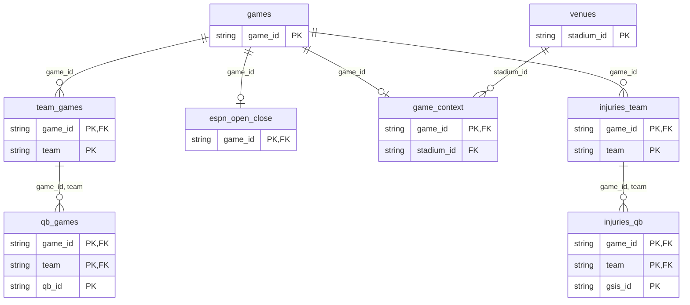

# Variable ledger

Generated by `scripts/write_variable_ledger.R` from `backtest/vvf/registry.R` and the committed VVF results. Do not edit it by hand: change the registry, re-run the script, and commit both. `tests/testthat/test-vvf-ledger.R` fails when they disagree.

Every variable has a row: its definition, source, when it becomes known (`known_at`), its unit test, its parameter count, its known defects with the phase that fixes each, and its latest results per anchor. A stage refuses any feature without a row or known after the decision (`vvf_assert_known_at()`).

## When a variable becomes known

| Class | Becomes known |
|---|---|
| `anchor` | At the decision: the anchor price itself |
| `schedule` | When the schedule entry is published (for a playoff game, after the previous round) |
| `results_w-2` | After week w-2's last game |
| `qb_prev_start` | After the team's previous game (week w-1) |
| `results_w-1` | After week w-1's last game, Monday night or Tuesday |
| `weather_fcst_tue18z` | When the forecast issued by Tuesday 18:00Z is published |
| `injury_wed` | When Wednesday's injury report is published |
| `injury_thu` | When Thursday's injury report is published |
| `injury_fri` | When Friday's (final) injury report is published |
| `weather_fcst_fri21z` | When the forecast issued by Friday 21:00Z is published |
| `gameday` | Kickoff: actual starters, the roof state, anything else fixed only on game day |

A post-hoc variable is refused at every decision point.

## Decision points

| Decision | Information set | Price | Use |
|---|---|---|---|
| `open_isa` | anchor, schedule, results_w-2, qb_prev_start | ESPN BET opener, no-vig | Confirmatory (IS-A, primary) |
| `open_isb` | anchor, schedule, results_w-2, qb_prev_start, results_w-1 | ESPN BET opener, no-vig | Secondary (IS-B): 'may not be executable' until the A0 opener-timing study |
| `tue_18z` | anchor, schedule, results_w-2, qb_prev_start, results_w-1, weather_fcst_tue18z | Kalshi mid at the first hourly candle at or after 18:00Z; ESPN Tuesday capture | Prospective 2026 |
| `fri_21z` | anchor, schedule, results_w-2, qb_prev_start, results_w-1, weather_fcst_tue18z, injury_wed, injury_thu, injury_fri, weather_fcst_fri21z | Kalshi mid at or after 21:00Z; ESPN capture | Prospective 2026, exploratory |
| `close` | anchor, schedule, results_w-2, qb_prev_start, results_w-1, weather_fcst_tue18z, injury_wed, injury_thu, injury_fri, weather_fcst_fri21z, gameday | No-vig close (nflverse consensus) | Close-anchored screens (v2 reproduction, G2 market labels) |

## Results shown

| Anchor | Decision | Stages | Window | Run | result_sha256 |
|---|---|---|---|---|---|
| close | close | S1, S2 | Tune 2018-2022 | `reports/2026-10-22/vvf-v2-repro` | 8d276fc5fdfd4985ba1323506aa8a52353ffc27556b21a06d0aae6056badbeb5 |
| close | close | S3, S4, S5 | Tune 2018-2022 | `reports/2026-10-28/vvf-a3b-close` | 7a43ce265582ea4bb433aee0d957a95ccc75e366709f5ec1556a9325345302fd |

S1 columns are the BH q-values within each family: outcome (moneyline, LR test with the anchor as offset), spread and total (F tests on the residual against the line). q < 0.05 is a signal; anything else is "no evidence" at the MDE in the run's `s1_features.csv`. S2 shows the VIF step (VIF <= 5, the declared-first feature kept), whether the effect's sign is the same in every season, and the feature x season LR test, all for the outcome family. S3 is the walk-forward skill of anchor + b x over the anchor alone, with its week-block bootstrap 95% CI. Admission takes S3 first, then S1's outcome q, then the run's S4 status of record (reports/2026-10-28/a3-research, section 5); a variable that passes all three is only a candidate until Confirm under G3. The opener anchor has no run yet: its inputs come from D1's archive (A4).

## Features

| Variable | Group | Definition | Source | known_at | Params | S1 close (q: outcome / spread / total) | S2 close (outcome) | S3 close (skill [CI]) | Admission | Defects | Unit test |
|---|---|---|---|---|---|---|---|---|---|---|---|
| `d_c1` | model vs market | logit(C1 Elo walk-forward) - lp_anchor; a team's rating moves only when it plays, so it uses results through the team's previous game | backtest/vvf/features.R: vvf_anchor_features; vvf_base_predictions (bt_elo_run) | results_w-1 | 1 | 0.963 / 0.998 / 0.896 | VIF kept; signs not stable; x season p 0.920 | -0.0008 [-0.0022, 0.0005] | excluded: no incremental skill on Tune (S3) | - | tests/testthat/test-vvf-features.R |
| `d_c2` | model vs market | logit(C2 EPA GLM walk-forward) - lp_anchor | backtest/vvf/features.R: vvf_anchor_features; vvf_base_predictions (bt_epa_walk_forward) | gameday | 1 | 0.963 / 0.967 / 0.896 | VIF kept; signs not stable; x season p 0.300 | -0.0005 [-0.0021, 0.0011] | excluded: no incremental skill on Tune (S3) | A3-STARTER | tests/testthat/test-vvf-features.R |
| `d_e1` | model vs market | logit(E1 = logit mean of C1 and C2) - lp_anchor; aliased with d_c1 and d_c2 when entered jointly | backtest/vvf/features.R: vvf_anchor_features; vvf_base_predictions (bt_e1) | gameday | 1 | 0.963 / 0.998 / 0.896 | VIF dropped, aliased; signs not stable; x season p 0.624 | -0.0000 [-0.0006, 0.0006] | excluded: no incremental skill on Tune (S3) | A3-STARTER | tests/testthat/test-vvf-features.R |
| `lp_anchor` | market shape | logit of the no-vig anchor price (v2's lp_c0 when the anchor is the close) | backtest/vvf/features.R: vvf_anchor_features | anchor | 1 | 0.963 / 0.998 / 0.896 | VIF kept; signs not stable; x season p 0.677 | -0.0001 [-0.0021, 0.0020] | excluded: no incremental skill on Tune (S3) | - | tests/testthat/test-vvf-features.R |
| `home_dog` | market shape | 1 if the anchor prices the home team below 0.5 | backtest/vvf/features.R: vvf_anchor_features | anchor | 1 | 0.963 / 0.596 / 0.896 | VIF kept; signs not stable; x season p 0.603 | -0.0005 [-0.0011, 0.0000] | excluded: no incremental skill on Tune (S3) | - | tests/testthat/test-vvf-features.R |
| `big_fav` | market shape | 1 if \|p_anchor - 0.5\| > 0.3 | backtest/vvf/features.R: vvf_anchor_features | anchor | 1 | 0.963 / 0.998 / 0.425 | VIF kept; signs not stable; x season p 0.008 | 0.0006 [-0.0019, 0.0031] | excluded: no incremental skill on Tune (S3) | - | tests/testthat/test-vvf-features.R |
| `rest_diff` | schedule | home rest days - away rest days | backtest/data/games.csv (nflverse schedule) via vvf_build_features | schedule | 1 | 0.963 / 0.967 / 0.896 | VIF kept; signs not stable; x season p 0.472 | -0.0005 [-0.0014, 0.0004] | excluded: no incremental skill on Tune (S3) | - | tests/testthat/test-vvf-v2-reproduction.R |
| `home_short` | schedule | 1 if the home team has 6 or fewer rest days | backtest/data/games.csv (nflverse schedule) via vvf_build_features | schedule | 1 | 0.963 / 0.998 / 0.896 | VIF kept; signs not stable; x season p 0.129 | -0.0007 [-0.0019, 0.0005] | excluded: no incremental skill on Tune (S3) | - | tests/testthat/test-vvf-v2-reproduction.R |
| `away_short` | schedule | 1 if the away team has 6 or fewer rest days | backtest/data/games.csv (nflverse schedule) via vvf_build_features | schedule | 1 | 0.963 / 0.998 / 0.896 | VIF kept; signs not stable; x season p 0.510 | -0.0005 [-0.0013, 0.0003] | excluded: no incremental skill on Tune (S3) | - | tests/testthat/test-vvf-v2-reproduction.R |
| `home_bye` | schedule | 1 if the home team has 13 or more rest days | backtest/data/games.csv (nflverse schedule) via vvf_build_features | schedule | 1 | 0.963 / 0.998 / 0.896 | VIF dropped, collinear with rest_diff, declared first (VIF 5.785 > 5); signs not stable; x season p 0.957 | -0.0008 [-0.0022, 0.0005] | excluded: no incremental skill on Tune (S3) | - | tests/testthat/test-vvf-v2-reproduction.R |
| `away_bye` | schedule | 1 if the away team has 13 or more rest days | backtest/data/games.csv (nflverse schedule) via vvf_build_features | schedule | 1 | 0.963 / 0.596 / 0.896 | VIF kept; signs not stable; x season p 0.056 | -0.0023 [-0.0061, 0.0015] | excluded: no incremental skill on Tune (S3) | - | tests/testthat/test-vvf-v2-reproduction.R |
| `thursday` | schedule | 1 for a Thursday game | backtest/vvf/data/game_context.csv (weekday) via vvf_build_features | schedule | 1 | 0.977 / 0.998 / 0.896 | VIF kept; signs not stable; x season p 0.571 | -0.0007 [-0.0023, 0.0010] | excluded: no incremental skill on Tune (S3) | - | tests/testthat/test-vvf-v2-reproduction.R |
| `div` | schedule | 1 for a division game | backtest/data/games.csv (nflverse schedule) via vvf_build_features | schedule | 1 | 0.989 / 0.998 / 0.896 | VIF kept; signs not stable; x season p 0.371 | -0.0008 [-0.0030, 0.0015] | excluded: no incremental skill on Tune (S3) | - | tests/testthat/test-vvf-v2-reproduction.R |
| `neutral_site` | schedule | 1 when the schedule's location is Neutral | backtest/data/games.csv (nflverse schedule) via vvf_build_features | schedule | 1 | 0.963 / 0.998 / 0.716 | VIF kept; signs not stable; x season p 0.256 | 0.0001 [-0.0027, 0.0028] | excluded: no incremental skill on Tune (S3) | - | tests/testthat/test-vvf-v2-reproduction.R |
| `late_reg` | schedule | 1 for regular-season weeks 15 and later | backtest/data/games.csv (nflverse schedule) via vvf_build_features | schedule | 1 | 0.977 / 0.964 / 0.716 | VIF kept; signs not stable; x season p 0.362 | -0.0003 [-0.0008, 0.0003] | excluded: no incremental skill on Tune (S3) | - | tests/testthat/test-vvf-v2-reproduction.R |
| `playoff` | schedule | 1 for a postseason game | backtest/data/games.csv (nflverse schedule) via vvf_build_features | schedule | 1 | 0.963 / 0.998 / 0.896 | VIF kept; signs not stable; x season p 0.818 | -0.0001 [-0.0012, 0.0010] | excluded: no incremental skill on Tune (S3) | - | tests/testthat/test-vvf-v2-reproduction.R |
| `away_travel_1000km` | travel and venue | great-circle km / 1000 from the away team's usual home stadium to the game venue | backtest/vvf/data/venues.csv via vvf_build_features (vvf_home_venues, vvf_haversine_km) | schedule | 1 | 0.963 / 0.596 / 0.896 | VIF kept; signs not stable; x season p 0.868 | -0.0007 [-0.0016, 0.0002] | excluded: no incremental skill on Tune (S3) | - | tests/testthat/test-vvf-v2-reproduction.R |
| `travel_diff_1000km` | travel and venue | away travel - home travel, km / 1000 | venues.csv via vvf_build_features | schedule | 1 | 0.963 / 0.967 / 0.716 | VIF dropped, collinear with away_travel_1000km, declared first (VIF 8.657 > 5); signs not stable; x season p 0.152 | -0.0007 [-0.0017, 0.0003] | excluded: no incremental skill on Tune (S3) | - | tests/testthat/test-vvf-v2-reproduction.R |
| `tz_shift_away` | travel and venue | UTC offset of the venue - UTC offset of the away team's home, hours, at kickoff | venues.csv via vvf_build_features (vvf_utc_offset_h) | schedule | 1 | 0.963 / 0.998 / 0.896 | VIF kept; signs not stable; x season p 0.636 | -0.0003 [-0.0023, 0.0018] | excluded: no incremental skill on Tune (S3) | - | tests/testthat/test-vvf-v2-reproduction.R |
| `abs_tz_away` | travel and venue | \|tz_shift_away\|: time zones crossed by the away team | venues.csv via vvf_build_features | schedule | 1 | 0.488 / 0.147 / 0.896 | VIF dropped, collinear with away_travel_1000km, declared first (VIF 13.061 > 5); signs stable; x season p 0.823 | -0.0005 [-0.0021, 0.0011] | excluded: no incremental skill on Tune (S3) | - | tests/testthat/test-vvf-v2-reproduction.R |
| `west_early` | travel and venue | 1 if the away team's body clock is before 11:00 and it travelled 2+ zones east | venues.csv via vvf_build_features (vvf_local_hour) | schedule | 1 | 0.896 / 0.998 / 0.716 | VIF kept; signs not stable; x season p 0.299 | -0.0004 [-0.0019, 0.0011] | excluded: no incremental skill on Tune (S3) | - | tests/testthat/test-vvf-v2-reproduction.R |
| `primetime` | travel and venue | 1 if the local kickoff is 19:30 or later (the final, post-flex kickoff) | venues.csv via vvf_build_features | schedule | 1 | 0.963 / 0.998 / 0.716 | VIF kept; signs not stable; x season p 0.221 | -0.0003 [-0.0008, 0.0003] | excluded: no incremental skill on Tune (S3) | - | tests/testthat/test-vvf-v2-reproduction.R |
| `altitude` | travel and venue | 1 if the venue is 1,000 m or higher | venues.csv via vvf_build_features | schedule | 1 | 0.963 / 0.998 / 0.425 | VIF kept; signs not stable; x season p 0.864 | -0.0009 [-0.0022, 0.0003] | excluded: no incremental skill on Tune (S3) | - | tests/testthat/test-vvf-v2-reproduction.R |
| `roof_closed` | travel and venue | 1 if the roof is dome or closed | backtest/data/games.csv (nflverse schedule) via vvf_build_features | gameday | 1 | 0.896 / 0.967 / 0.314 | VIF kept; signs stable; x season p 0.817 | 0.0002 [-0.0013, 0.0016] | excluded: no incremental skill on Tune (S3) | A3-ROOF | tests/testthat/test-vvf-v2-reproduction.R |
| `turf` | travel and venue | 1 if the surface is not grass | game_context.csv (surface) via vvf_build_features | schedule | 1 | 0.963 / 0.998 / 0.327 | VIF kept; signs not stable; x season p 0.695 | -0.0026 [-0.0072, 0.0022] | excluded: no incremental skill on Tune (S3) | - | tests/testthat/test-vvf-v2-reproduction.R |
| `inj_diff_qb` | injuries and QB | home - away status-weighted QB injury count (Out 1, Doubtful 0.75, Questionable 0.25) | backtest/vvf/data/injuries_team.csv via vvf_injury_index | gameday | 1 | 0.963 / 0.998 / 0.896 | VIF kept; signs not stable; x season p 0.488 | 0.0000 [-0.0018, 0.0018] | excluded: no incremental skill on Tune (S3) | A3-INJ-CUTOFF | tests/testthat/test-vvf-features.R |
| `inj_diff_ol` | injuries and QB | home - away status-weighted offensive-line injury count | injuries_team.csv via vvf_injury_index | gameday | 1 | 0.963 / 0.998 / 0.716 | VIF kept; signs not stable; x season p 0.154 | -0.0004 [-0.0029, 0.0019] | excluded: no incremental skill on Tune (S3) | A3-INJ-CUTOFF | tests/testthat/test-vvf-features.R |
| `inj_diff_skill` | injuries and QB | home - away status-weighted WR/TE/RB injury count | injuries_team.csv via vvf_injury_index | gameday | 1 | 0.963 / 0.596 / 0.896 | VIF kept; signs not stable; x season p 0.531 | 0.0004 [-0.0016, 0.0023] | excluded: no incremental skill on Tune (S3) | A3-INJ-CUTOFF | tests/testthat/test-vvf-features.R |
| `inj_diff_dl` | injuries and QB | home - away status-weighted defensive-line injury count | injuries_team.csv via vvf_injury_index | gameday | 1 | 0.977 / 0.998 / 0.896 | VIF kept; signs not stable; x season p 0.655 | -0.0004 [-0.0013, 0.0004] | excluded: no incremental skill on Tune (S3) | A3-INJ-CUTOFF | tests/testthat/test-vvf-features.R |
| `inj_diff_lb` | injuries and QB | home - away status-weighted linebacker injury count | injuries_team.csv via vvf_injury_index | gameday | 1 | 0.896 / 0.596 / 0.896 | VIF kept; signs not stable; x season p 0.327 | -0.0019 [-0.0038, -0.0001] | excluded: no incremental skill on Tune (S3) | A3-INJ-CUTOFF | tests/testthat/test-vvf-features.R |
| `inj_diff_db` | injuries and QB | home - away status-weighted defensive-back injury count | injuries_team.csv via vvf_injury_index | gameday | 1 | 0.963 / 0.998 / 0.896 | VIF kept; signs not stable; x season p 0.503 | -0.0010 [-0.0044, 0.0023] | excluded: no incremental skill on Tune (S3) | A3-INJ-CUTOFF | tests/testthat/test-vvf-features.R |
| `inj_diff_all` | injuries and QB | sum of the six group differences; aliased with them when entered jointly | injuries_team.csv via vvf_injury_index | gameday | 1 | 0.963 / 0.998 / 0.716 | VIF dropped, aliased; signs not stable; x season p 0.775 | -0.0006 [-0.0029, 0.0016] | excluded: no incremental skill on Tune (S3) | A3-INJ-CUTOFF | tests/testthat/test-vvf-features.R |
| `qb_out_diff` | injuries and QB | home - away: the previous game's starter is listed Out or Doubtful | injuries_qb.csv via vvf_qb_out | gameday | 1 | 0.963 / 0.998 / 0.896 | VIF kept; signs not stable; x season p 0.947 | 0.0005 [-0.0020, 0.0029] | excluded: no incremental skill on Tune (S3) | A3-INJ-CUTOFF | tests/testthat/test-vvf-features.R |
| `qb_change_diff` | injuries and QB | home - away: this game's actual starter differs from the previous starter | games.csv via vvf_qb_out | gameday | 1 | 0.963 / 0.998 / 0.425 | VIF kept; signs not stable; x season p 0.310 | -0.0006 [-0.0020, 0.0006] | excluded: no incremental skill on Tune (S3) | A3-STARTER | tests/testthat/test-vvf-features.R |
| `ref_ml_resid` | officials | the assigned referee's prior-season mean of (y - p_close), shrunk with 50 pseudo-games | game_context.csv (referee) via vvf_referee_tendencies | gameday | 1 | 0.977 / 0.998 / 0.896 | VIF kept; signs not stable; x season p 0.635 | -0.0002 [-0.0014, 0.0010] | excluded: no incremental skill on Tune (S3) | A3-REF | tests/testthat/test-vvf-features.R |
| `ref_tot_resid` | officials | the assigned referee's prior-season mean of (total - total_line), shrunk with 50 pseudo-games | game_context.csv (referee) via vvf_referee_tendencies | gameday | 1 | 0.963 / 0.998 / 0.896 | VIF kept; signs not stable; x season p 0.486 | -0.0003 [-0.0038, 0.0032] | excluded: no incremental skill on Tune (S3) | A3-REF | tests/testthat/test-vvf-features.R |
| `cold_obs` | weather (observed, post-hoc) | 1 for an outdoor game observed at 32 F or colder | game_context.csv (temp_obs) via vvf_build_features | gameday (post-hoc) | 1 | not screened (post-hoc) | - | - | - | - | tests/testthat/test-vvf-v2-reproduction.R |
| `windy_obs` | weather (observed, post-hoc) | 1 for an outdoor game observed at 15 mph or more | game_context.csv (wind_obs) via vvf_build_features | gameday (post-hoc) | 1 | not screened (post-hoc) | - | - | - | - | tests/testthat/test-vvf-v2-reproduction.R |

## Input tables

The tables every stage reads, with each key (PK) and reference (FK), from `backtest/vvf/input_schema.R`. The checks below run on the committed inputs each time the ledger is rendered: unique keys, references that resolve, each team row's team one of its game's two franchises, at most two team rows per game, and no sealed season. Any violation would show here as a count above 0.

| Check | Table | Detail | Violations |
|---|---|---|---|
| key unique | games | game_id | 0 |
| no sealed season | games | 2025 | 0 |
| key unique | team_games | game_id, team | 0 |
| reference resolves | team_games | game_id -> games.game_id | 0 |
| team in game | team_games | team is the home or away franchise | 0 |
| rows per game | team_games | at most 2 | 0 |
| no sealed season | team_games | 2025 | 0 |
| key unique | qb_games | game_id, team, qb_id | 0 |
| reference resolves | qb_games | game_id, team -> team_games.game_id, team | 0 |
| no sealed season | qb_games | 2025 | 0 |
| key unique | espn_open_close | game_id | 0 |
| reference resolves | espn_open_close | game_id -> games.game_id | 0 |
| no sealed season | espn_open_close | 2025 | 0 |
| key unique | game_context | game_id | 0 |
| reference resolves | game_context | game_id -> games.game_id | 0 |
| reference resolves | game_context | stadium_id -> venues.stadium_id | 0 |
| no sealed season | game_context | 2025 | 0 |
| key unique | venues | stadium_id | 0 |
| key unique | injuries_team | game_id, team | 0 |
| reference resolves | injuries_team | game_id -> games.game_id | 0 |
| team in game | injuries_team | team is the home or away franchise | 0 |
| rows per game | injuries_team | at most 2 | 0 |
| no sealed season | injuries_team | 2025 | 0 |
| key unique | injuries_qb | game_id, team, gsis_id | 0 |
| reference resolves | injuries_qb | game_id, team -> injuries_team.game_id, team | 0 |
| no sealed season | injuries_qb | 2025 | 0 |

## Engine variables, settings and market inputs

| Variable | Kind | Group | Definition | Source | known_at | Params | Defects | Evidence | Unit test |
|---|---|---|---|---|---|---|---|---|---|
| `hfa` | engine | engine means | Home-field advantage points per team | NFLsimulation.R: team_hfa_tbl, hfa_tbl | gameday (post-hoc) | not counted yet (G1) | M5, F11 | - | none |
| `rho_score` | engine | engine means | Score correlation of the Gaussian copula (RHO_SCORE from rho_hat) | NFLsimulation.R: RHO_SCORE, rho_hat | gameday (post-hoc) | not counted yet (G1) | M5 | - | none |
| `pts_cap` | engine | engine means | Points cap PTS_CAP_HI (max team points + 2, at least 60) | NFLsimulation.R: PTS_CAP_HI | gameday (post-hoc) | not counted yet (G1) | M5 | - | none |
| `ppd_tables` | engine | engine means | Production points-per-drive tables off_ppd_tbl / def_ppd_tbl (recency-weighted) | NFLsimulation.R: off_ppd_tbl, def_ppd_tbl | results_w-1 | not counted yet (G1) | A3-PPD | - | none |
| `glmm_prior` | engine | engine means | NB-GLMM team ratings used as a mean prior, weight GLMM_BLEND_W | NFLsimulation.R: glmm_preds (glmmTMB) | results_w-1 | not counted yet (G1) | M9 | - | none |
| `qb_starter` | engine | engine means | QB adjustment and QB change | NFLsimulation.R QB adjustment; injury_scalp.R: default_quality | gameday | not counted yet (G1) | A3-QB | - | tests/testthat/test-backup-qb.R |
| `team_tz` | engine | engine means | Team time-zone table team_tz | NFLsimulation.R: team_tz | schedule | not counted yet (G1) | A3-TZ | - | none |
| `injury_adj` | engine | engine means | Injury adjustment of the scoring means | NFLsimulation.R / injury_scalp.R injury impacts | injury_fri | not counted yet (G1) | M18 | - | tests/testthat/test-injury-model.R |
| `weather` | engine | engine means | Venue weather and dome flags | NFLsimulation.R: stadium_coords, get_hourly_weather | weather_fcst_fri21z (post-hoc) | not counted yet (G1) | M21, S3, F6 | - | tests/testthat/test-weather.R |
| `neutral_travel` | engine | engine means | Travel for neutral-site games | NFLsimulation.R travel terms | schedule | not counted yet (G1) | A3-NEUTRAL | - | tests/testthat/test-schedule-context.R |
| `turnover_term` | engine | engine means | Turnover adjustment to_adj_pts | NFLsimulation.R: to_adj_pts | results_w-1 | not counted yet (G1) | M22 | - | tests/testthat/test-mu-terms.R |
| `safe_mu_sd` | engine | engine guards | Substitutions for invalid means and SDs: simulate_game_nb's 21.5 mean and 10.0 SD; safe_mu (21) and safe_sd (7) | NFLsimulation.R: simulate_game_nb; R/utils.R: safe_mu, safe_sd | schedule | 4 | A3-SAFE | - | tests/testthat/test-simulate-game-nb.R |
| `dup_loaders` | engine | engine data | load_defense_rankings and load_red_zone_efficiency, each defined twice | R/correlated_props.R, R/red_zone_data.R, sports/nfl/props/data_sources.R | results_w-1 | not counted yet (G1) | A3-DUP, P13 | - | tests/testthat/test-module-duplicates.R |
| `calibrator` | engine | engine calibration | Ensemble spline/isotonic calibrator (ensemble_calibration_*) | NFLsimulation.R calibration path | gameday (post-hoc) | not counted yet (G1) | M4, F12 | - | tests/testthat/test-calibration.R |
| `devig` | market | market | Proportional devig of a two-way moneyline (the C0 and anchor prices) | backtest/common.R: bt_novig_home | anchor | 0 | - | M3 (pre-registered): on 4,426 games 2006-2022 every alternative (additive, power, Shin, odds ratio) differs from proportional by less than 0.0001 log-loss, Holm p = 1; proportional stays. Calibration slope 1.025 [0.940, 1.110], intercept -0.047 [-0.111, +0.017] (reports/2026-10-21/devig-study/RESULTS.md, docs/modeling-roadmap 625ef27) | tests/testthat/test-backtest-games.R |
| `RECENCY_HALFLIFE` | setting | setting | Recency half-life in games for recency_weights() and the calibration path's rec_wts (config.R default 3.0) | config.R: RECENCY_HALFLIFE | schedule | 1 | A3-S5 | - | none yet (A3b S5 validation curve) |
| `GLMM_BLEND_W` | setting | setting | Weight of the NB-GLMM prior in the means (config.R default 0.38) | config.R: GLMM_BLEND_W | schedule | 1 | A3-S5 | - | none yet (A3b S5 validation curve) |
| `SOS_STRENGTH` | setting | setting | Strength-of-schedule exponent (config.R default 0.45) | config.R: SOS_STRENGTH | schedule | 1 | A3-S5 | - | none yet (A3b S5 validation curve) |
| `SHRINKAGE` | setting | setting | Market shrinkage of the published probability (config.R default 0.70) | config.R: SHRINKAGE | schedule | 1 | A3-S5 | - | none yet (A3b S5 validation curve) |
| `N_RECENT` | setting | setting | Recent games per team in recent form (config.R default 6) | config.R: N_RECENT | schedule | 1 | A3-S5 | - | none yet (A3b S5 validation curve) |

## Defects

| ID | Variable | Defect | Fix | Phase | Status | Audit |
|---|---|---|---|---|---|---|
| A3-STARTER | `d_c2` | Uses the game's actual starting QB (C2's QB EPA features), unknown at the opener | PC-C2 rebuilds C2 on IS-A with the previous starter | A4 | open | master plan 2026-10-19, Context |
| A3-STARTER | `d_e1` | Uses the game's actual starting QB (C2's QB EPA features), unknown at the opener | PC-C2 rebuilds C2 on IS-A with the previous starter | A4 | open | master plan 2026-10-19, Context |
| A3-ROOF | `roof_closed` | For retractable roofs the state is decided on game day; nflverse's roof is NA before kickoff for them | Split into a fixed dome flag (schedule) and the retractable state (gameday) | A4 | open | F6, OUTPUT_AUDIT |
| A3-INJ-CUTOFF | `inj_diff_qb` | Built with the kickoff - 6 h rule (date_modified + 6 h < kickoff), so a Saturday update counts; no report-day cutoff | Rebuild injuries_team/injuries_qb with a report-day cutoff (date_modified <= Friday 21:00Z) to earn class injury_fri | A4 | open | design 2026-10-20, section 2 |
| A3-INJ-CUTOFF | `inj_diff_ol` | Built with the kickoff - 6 h rule (date_modified + 6 h < kickoff), so a Saturday update counts; no report-day cutoff | Rebuild injuries_team/injuries_qb with a report-day cutoff (date_modified <= Friday 21:00Z) to earn class injury_fri | A4 | open | design 2026-10-20, section 2 |
| A3-INJ-CUTOFF | `inj_diff_skill` | Built with the kickoff - 6 h rule (date_modified + 6 h < kickoff), so a Saturday update counts; no report-day cutoff | Rebuild injuries_team/injuries_qb with a report-day cutoff (date_modified <= Friday 21:00Z) to earn class injury_fri | A4 | open | design 2026-10-20, section 2 |
| A3-INJ-CUTOFF | `inj_diff_dl` | Built with the kickoff - 6 h rule (date_modified + 6 h < kickoff), so a Saturday update counts; no report-day cutoff | Rebuild injuries_team/injuries_qb with a report-day cutoff (date_modified <= Friday 21:00Z) to earn class injury_fri | A4 | open | design 2026-10-20, section 2 |
| A3-INJ-CUTOFF | `inj_diff_lb` | Built with the kickoff - 6 h rule (date_modified + 6 h < kickoff), so a Saturday update counts; no report-day cutoff | Rebuild injuries_team/injuries_qb with a report-day cutoff (date_modified <= Friday 21:00Z) to earn class injury_fri | A4 | open | design 2026-10-20, section 2 |
| A3-INJ-CUTOFF | `inj_diff_db` | Built with the kickoff - 6 h rule (date_modified + 6 h < kickoff), so a Saturday update counts; no report-day cutoff | Rebuild injuries_team/injuries_qb with a report-day cutoff (date_modified <= Friday 21:00Z) to earn class injury_fri | A4 | open | design 2026-10-20, section 2 |
| A3-INJ-CUTOFF | `inj_diff_all` | Built with the kickoff - 6 h rule (date_modified + 6 h < kickoff), so a Saturday update counts; no report-day cutoff | Rebuild injuries_team/injuries_qb with a report-day cutoff (date_modified <= Friday 21:00Z) to earn class injury_fri | A4 | open | design 2026-10-20, section 2 |
| A3-INJ-CUTOFF | `qb_out_diff` | Built with the kickoff - 6 h rule (date_modified + 6 h < kickoff), so a Saturday update counts; no report-day cutoff | Rebuild injuries_team/injuries_qb with a report-day cutoff (date_modified <= Friday 21:00Z) to earn class injury_fri | A4 | open | design 2026-10-20, section 2 |
| A3-STARTER | `qb_change_diff` | Uses the game's actual starting QB (C2's QB EPA features), unknown at the opener | PC-C2 rebuilds C2 on IS-A with the previous starter | A4 | open | master plan 2026-10-19, Context |
| A3-REF | `ref_ml_resid` | The referee assignment's publication time is not recorded | Date the assignment (it is reported mid-week) before any pre-close use | A4 | open | - |
| A3-REF | `ref_tot_resid` | The referee assignment's publication time is not recorded | Date the assignment (it is reported mid-week) before any pre-close use | A4 | open | - |
| M5 | `hfa` | Windows include later games; team n() counts unplayed games | features_asof; count played games only; append canary | G1 | open | reports/2026-09-28/AUDIT.md |
| F11 | `hfa` | Built only for the simulated week's teams, so a team on a bye had no home field in any of its calibration games: both means went NA and simulate_game_nb used 21.5 for each (317 of 1,355 games in the 2026 week-7 run) | team_hfa_table() for every schedule team, assert_finite_means() and calibration cache version 4L (fix/calib-hfa-all-teams 922dae6, owner-gated, unmerged); then the A3a bye-week regression check | F11 fix | open | reports/2026-10-21/OUTPUT_AUDIT.md (docs/modeling-roadmap) 'F11 root cause' (e99476d) |
| M5 | `rho_score` | Windows include later games; team n() counts unplayed games | features_asof; count played games only; append canary | G1 | open | reports/2026-09-28/AUDIT.md |
| M5 | `pts_cap` | Windows include later games; team n() counts unplayed games | features_asof; count played games only; append canary | G1 | open | reports/2026-09-28/AUDIT.md |
| A3-PPD | `ppd_tables` | Code read 2026-10-22: the summaries have no week cut, so re-running a past week would use later games' drives (to confirm) | features_asof cut, with an append canary | G1 | open | A3 planner |
| M9 | `glmm_prior` | No season term, a silent try, an unversioned NB cache key | Add a season term, log failures, version the key | G1 | open | reports/2026-09-28/AUDIT.md |
| A3-QB | `qb_starter` | Uses the actual starter; backup quality is silently 0.35 under the 2026 depth-chart schema | Use the previous starter at the opener; flag the schema change (injury_scalp.R edit is an owner STOP) | G1 | open | master plan 2026-10-19, A3a |
| A3-TZ | `team_tz` | Keyed LAR while nflverse uses LA, so the join misses | Fix the key (engine edit, owner STOP) | G1 | open | master plan 2026-10-19, A3a |
| M18 | `injury_adj` | Computed but never in the means | Admit only through the test, at the close and the Friday decision point | G2 | open | reports/2026-09-29/AUDIT-ADDENDUM.md |
| M21 | `weather` | Joined by stadium name; history fetched from the forecast endpoint | Key by stadium_id; use historical forecasts; log misses | G2 | open | reports/2026-09-29/AUDIT-ADDENDUM.md |
| S3 | `weather` | No timeout or retry; failure returns NULL silently; neutral sites fall back to Kansas | Timeout, loud failure, venue coordinates | G2 | open | reports/2026-09-28/AUDIT.md |
| F6 | `weather` | Three 2026 week-7 games used league-average weather (PAR00 missing, HOU00 renamed, ATL97 roof NA) | Key on stadium_id, add foreign venues, explicit unknown roof state | C2 | open | reports/2026-10-21/OUTPUT_AUDIT.md (docs/modeling-roadmap) |
| A3-NEUTRAL | `neutral_travel` | Measured from the home stadium | Venue coordinates | G2 | open | master plan 2026-10-19, A3a |
| M22 | `turnover_term` | NaN source | Explicit NA rule plus a test | G2 | open | reports/2026-09-29/AUDIT-ADDENDUM.md |
| A3-SAFE | `safe_mu_sd` | Silent substitution. F11 showed its cost (317 calibration games at 21.5-21.5). The calibration path is covered by assert_finite_means() once 922dae6 merges; the slate path's safe_mu(21) / safe_sd(7) remain | Remove the substitutions; a missing mean or SD stops the run | G1 | open | master plan 2026-10-19, A3a |
| A3-DUP | `dup_loaders` | Each defined twice | Keep one; a source-order test (deletion needs approval) | P1 | open | master plan 2026-10-19, A3a |
| P13 | `dup_loaders` | load_defense_rankings() always errors, so defense adjustments are always neutral | PR #216 | P1 | open | reports/2026-09-28/AUDIT.md |
| M4 | `calibrator` | Trained on the final score | Remove after proof it is diagnostic only | X | open | reports/2026-09-28/AUDIT.md |
| F12 | `calibrator` | Still loaded and printed as SPLINE; home_win_prob_cal equals home_win_prob | Track X removal with that evidence | X | open | reports/2026-10-21/OUTPUT_AUDIT.md (docs/modeling-roadmap) |
| A3-S5 | `RECENCY_HALFLIFE` | Never tuned by a validation curve; the S5 curve needs a point-in-time C3 walk-forward | Run the A3b S5 validation curve with the one-SE rule on Tune 2018-22 once G1's predict_week exists | G2 | open | - |
| A3-S5 | `GLMM_BLEND_W` | Never tuned by a validation curve; the S5 curve needs a point-in-time C3 walk-forward | Run the A3b S5 validation curve with the one-SE rule on Tune 2018-22 once G1's predict_week exists | G2 | open | - |
| A3-S5 | `SOS_STRENGTH` | Never tuned by a validation curve; the S5 curve needs a point-in-time C3 walk-forward | Run the A3b S5 validation curve with the one-SE rule on Tune 2018-22 once G1's predict_week exists | G2 | open | - |
| A3-S5 | `SHRINKAGE` | Never tuned by a validation curve; the S5 curve needs a point-in-time C3 walk-forward | Run the A3b S5 validation curve with the one-SE rule on Tune 2018-22 once G1's predict_week exists | G2 | open | - |
| A3-S5 | `N_RECENT` | Never tuned by a validation curve; the S5 curve needs a point-in-time C3 walk-forward | Run the A3b S5 validation curve with the one-SE rule on Tune 2018-22 once G1's predict_week exists | G2 | open | - |

## Disclosures

| ID | Disclosure | Source |
|---|---|---|
| F3 | The production calibration window includes 2025. Every 2026 production run before PR #218, and the 2026-10-13 C3 retest, printed in-sample 2025 model-against-market figures (week 7: calibration Brier, model 0.214 against market 0.212; those figures predate the F11 fix and are contaminated by it). | reports/2026-10-21/OUTPUT_AUDIT.md (docs/modeling-roadmap) |
| F11-CALIB | Every calibration-based figure computed before the F11 fix (fix/calib-hfa-all-teams 922dae6) merges is contaminated in any week with byes: the bye teams' calibration games were simulated at 21.5-21.5. That includes the output audit's F3, F4 and F5 figures. They are re-measured after the fix merges. | reports/2026-10-21/OUTPUT_AUDIT.md (docs/modeling-roadmap) 'F11 root cause' |
| CLV-POWER | 2025 ESPN opener and close prices, with 2025 scores, were read once, on 2026-09-29, by the A2 power study. No model, threshold or feature was chosen on them; the 400-pick gate's sigma came from it. | design 2026-10-20, section 6 |
| V1-BUILDER | backtest/build_inputs.R (v1) also reads that 2024-2025 price file to build backtest/data/espn_open_close.csv, keeping 2024 rows only (found by the A3 planner on 2026-10-22). The owner decides whether it should refuse the file. | backtest/build_inputs.R |
| V1-CLV-2024 | v1 already looked at 2024 opener CLV for C1, C2, E1 and K[E1], so 2024 is secondary evidence for PC-C2. | design 2026-10-20, section 6 |
| V2-TUNE | v2's close-anchored screen (PR #205) chose nothing on Confirm 2023-24 or the 2025 holdout; it used Tune 2018-22, and this framework reproduces its numbers on the same inputs. | reports/2026-09-30/validation-sprint/REPORT.md (PR #205) |
| F11B | F11b: nflverse play-by-play files the 2019 Raiders as LV while the schedules say OAK (SD and STL likewise before their moves), so every 2019 Raiders calibration game had no drive inputs and was simulated at 21.5-21.5 on main (16 games in the 2024 week 5 positive control). The owner chose franchise codes on 2026-10-28: the engine fix (PR #223, c1144c8) maps the schedule and the injury table to them, and is not merged. | reports/2026-10-26/f11-bye-week-main (PR #223 comment) |
| V2-JOINT-DF | The known-answer target changes: v2's moneyline joint test counted df 30 for 29 estimable terms. With df 29, chi-square 26.933 gives p 0.575, where v2 printed 0.627 (design section 4 names p = 0.63). The owner acknowledges it. | reports/2026-10-22/vvf-v2-repro/run_meta.json |
| JOINT-WALD | Each joint test reports p_test (LR or F, model-based), p_joint_wild (a restricted wild cluster score bootstrap with diagonal studentization, Rademacher, B = 9,999) and p_joint = max(p_test, p_joint_wild), the p of record (A3b). p_wald_robust, the cluster-robust chi-square(k) Wald, is kept for v2 fidelity and is not size-controlled: under a true null with 107 week clusters and 29 to 34 coefficients it rejects 0.30-0.69 of the time at a nominal 5%, where the diagonal score bootstrap rejects 0.041-0.059 (0.054 on one season, where the Wald is undefined). On v2's inputs its p from 1.2e-06 to 0.45 is no evidence beside p_test from 0.22 to 0.58 and p_joint_wild from 0.18 to 0.60: no feature set is jointly significant in any family. It is NA when its covariance is singular. Dropping it is the owner's decision. | reports/2026-10-28/a3-research/RESEARCH.md section 2; reports/2026-10-28/a3-research/joint_size.csv; reports/2026-10-28/a3-research/joint_size_linear.csv; reports/2026-10-22/vvf-v2-repro/s1_joint.csv |
| CLUSTER-UNIT | The cluster unit is the season-week (backtest/common.R wk), kept on the research's evidence: residuals against the close show no within-cluster correlation at any candidate unit (ICC 0.0000 by season-week, week of season, game day and team-season, except 0.0006 for totals by team-season), and the median design effect of clustering is 1.004-1.064 at every unit. One season has 22 clusters, under 30, so the wild bootstrap gives its p-value there and no sandwich CI is reported; the pooled 2023-24 opener window has 44. | reports/2026-10-28/a3-research/RESEARCH.md section 3; reports/2026-10-28/a3-research/cluster_icc.csv; reports/2026-10-28/a3-research/cluster_design_effects.csv; backtest/common.R |
| A3-FLEX | primetime uses the final, post-flex kickoff and is classed schedule. The NFL announces a weeks 5-17 Sunday-night flex no later than 12 days before the game and week 18's primetime games no later than 6 days before, so a flex is public at the close and at a weeks 5-17 opener; week 18's can follow its opener. Of 1,372 Tune games 51 (3.7%) changed and 19 were late (a date or venue change, or weeks 17-18); neither predicts the moneyline or ATS against the close (p 0.33-0.81), and dropping the changed games changes 0 of 108 S1 verdicts. No adjustment and no feature; A4 retests at the opener. | reports/2026-10-28/a3-research/RESEARCH.md section 4; reports/2026-10-28/a3-research/late_tests.csv; reports/2026-10-28/a3-research/late_s1_sensitivity.csv; backtest/vvf/registry.R primetime |
| S4-NULL | The spec's shuffled-labels control fails by construction for S3's anchor-offset model: permuting y breaks the anchor, and a feature that tracks it then beats it (7 of 36 intervals wholly above 0 on Tune; skill correlates 0.954 with \|cor(x, anchor)\|; a claim in 5 of 5 replicates). Proposed, for the owner to sign: the anchor null, y redrawn as Bernoulli(p_anchor) (consistency resampling), gates in its place, with the permuted-x null reported; each passes when S3's claim rule claims no feature (0 of 5 replicates claimed under each). Until then s4_status follows the spec, and s4_status_amended is reported beside it. | reports/2026-10-28/a3-research/RESEARCH.md section 1; reports/2026-10-28/a3-research/s4_nulls.csv; reports/2026-10-28/a3-research/s4-null-diagnostic.csv; backtest/vvf/s4_controls.R |
