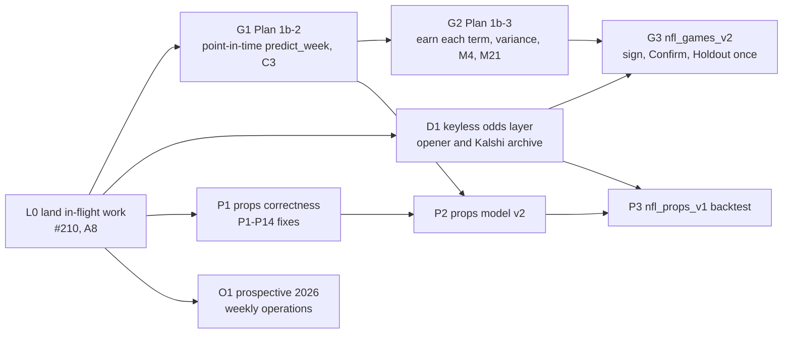

# NFL Modeling Roadmap (rewritten 2026-10-12)

> **For agentic workers:** this is a roadmap, not a task plan. Each phase below gets its own task-level plan, written with superpowers:writing-plans when the phase before it lands. Execute that plan with superpowers:subagent-driven-development. The "how we work" loop in §5 binds every phase.

**Goal:** Finish the simulator so it can be judged honestly against the market, point-in-time and under a signed protocol. Measure betting value where it can exist (closing-line value at decision time). Bring player props to the same standard.

**Architecture:**
- **One prediction path.** The R engine produces game predictions through a single point-in-time `predict_week()`. `run_week.R`, the walk-forward backtest and the weekly web bundle all call it.
- **Hash-locked protocols** (`backtest/eval_windows/*.json` plus a frozen `PROTOCOL.md`) decide what is scored and when.
- **Results** go to `RESULT.md` and `docs/EVIDENCE_LEDGER.md`.
- **The app** (offline `npm run local`, online `weekly-sim.yml`) shows a model line only when it passes its gates.

**Tech stack:**
- **Model:** R 4.5.1 with renv. The packages in use are already locked: glmnet, xgboost, mgcv, lme4, httr2, future, jsonlite, digest.
- **Tests and CI:** testthat; the golden master (`scripts/golden_master.R`, recorded by CI on Linux); GitHub Actions.
- **Web:** Next.js 16, Drizzle and PostgreSQL, used for display only.

**Spec:**
- `docs/superpowers/specs/2026-09-28-nfl-overhaul-design.md` §5 Phases 1–5.
- `docs/superpowers/specs/2026-09-29-model-shootout-design.md`, including the A2 decisions.
- `docs/superpowers/specs/2026-09-29-data-sources-addendum.md`.

**This roadmap supersedes** the phase order of spec §5 for everything after Plan 1b-1, and the "Roadmap after Plan 1b-1" section of `docs/superpowers/plans/2026-10-01-phase1b-1-explicit-model.md`. Plan 1b-4's bundle and charts already shipped in A8.

---

## 1. Where the evidence stands (2026-10-12)

| Finding | Number | Source |
|---|---|---|
| No game candidate beats the no-vig close | Model-only candidates are 4.5–5.6% worse than the close on Brier (Confirm 2023–24, 570 games). The market-anchored blends are statistically indistinguishable from it. | `reports/2026-09-29/backtest-games-v1/RESULT.md:3` |
| CLV against the opener is promising but not evaluable | C2 +93 bps [+40, +149] and K[E1] +66 bps [+8, +125] (ESPN BET opener → close). Each has only 199–214 picks, below the 400-pick gate. | `RESULT.md:103-110` |
| No blend or mesh beats the close | The best is S1 at +0.07% [−0.10%, +0.23%] Brier skill. BH q = 1.000 across 39 candidates. S1's meta-learner gives all seven base models a weight of 0; it is the close plus a walk-forward intercept. | `reports/2026-10-01/blend-research/REPORT.md:12-15` (PR #209) |
| Calibration maps do not help anchored blends | Isotonic calibration hurts them. | `reports/2026-09-30/backtest-games-v2/PROTOCOL-DRAFT.md` §4 (PR #205) |
| Kalshi prop history is usable | GO for anytime TD and passing/rushing/receiving yards: at least 300 settled player-games with a pre-kickoff price; passing yards has 390. The window is the 2025 season plus 2026 weeks 1–3. The 2026 anytime-TD series (KXNFLTD) rests on n = 3 and must be re-measured. | `reports/2026-09-29/DATA_SOURCES_SPIKE.md:20-38` |
| ESPN BET prop archive | Line movement only. It has effectively no historical anytime-TD prices (265 settled player-games). | `DATA_SOURCES_SPIKE.md:40-46` |
| ESPN game odds | Open and close moneylines for every sampled game from 2023. 2022 has the close only; 2018–2021 have neither. | `DATA_SOURCES_SPIKE.md:47-50` |
| The simulator's means are explicit | Means are `base + hfa`. The other 13 terms are computed and logged but not simulated. Cache keys are at v3. | PR #210 (Plan 1b-1), `CHANGELOG.md` |
| Calibration in production | `CALIBRATION_METHOD` defaults to `"spline"`. The spline file is gone, so the blend passes through a fallback map fit on the calibration history (audit M4, still open). `SHRINKAGE` is 0.70. | `config.R:91`, `:722`; `NFLsimulation.R:5617-5700` |

**What follows from this.** Every method tried so far fails to beat the closing moneyline. The plausible edges are:
- decision-time value: CLV at the opener, from ESPN 2023+ and Kalshi 2025+;
- player props, where Kalshi now provides priced history.

The roadmap spends its effort there, and finishes the simulator so that it can be judged rather than assumed.

**Open audit items this roadmap closes:**
- **Game:** M4, M5, M6, M8, M9, M13 (values it touches), M21, and the 1b-1 review deferrals M1, M2, M3.
- **Props:** P1–P14.
- **Data:** S2, S4.

## 2. Global constraints (owner rules, unchanged)

- **Keyless data only:** no API keys and no free trials. At most 1 request per second, a truthful user agent, and a 20 s timeout. Never work around an HTTP 403 or 429.
- **The 2025 game Holdout stays sealed** until `nfl_games_v2` is signed with C3 (or the owner decides to go without C3). It is scored once, for every candidate together (A2 decision 3).
- **Stop and ask the owner before:**
  - changing config.R defaults;
  - editing `NFLsimulation.R`, `NFLmarket.R` or `injury_scalp.R` beyond an approved item;
  - adding a dependency (`renv.lock` or `web/package.json`). `httptest2` is not in renv.lock;
  - changing `R/data_validation.R` signatures;
  - editing `backtest/eval_windows/*.json` or any frozen `PROTOCOL.md`;
  - deleting any file;
  - merging any PR.
- **Numbers in docs.** A number goes in a doc only if a script or CI produced it, and claims carry ledger statuses. No silent fallbacks: every data problem is logged and flagged.
- **Golden master.** Every PR's prediction changes are attributed by CI (Linux). Run local R gates with a fresh `HOME` until the v3 cache key is on main.
- **Branches and commits.** One branch per defect or phase, in a git worktree; fix and feat are never mixed. Commit trailer: `Co-Authored-By: Claude Opus 5.5 <noreply@anthropic.com>`. PR footer: `🤖 Generated with [Claude Code](https://claude.com/claude-code)`.

## Review Focus

These are the five failure modes most likely to bite, and the phase whose plan must pin each one with a test:
1. **A feature silently uses data from after the slate's cutoff.** This includes a season-level aggregate that includes the current week. G1's leak canary and its prod = backtest parity test pin it; every later term (G2) reuses the canary.
2. **A historical props run is priced with current lines** (P14). P1's test pins it: a 2024 week 16 run never sees a line captured later than its kickoff.
3. **A local result differs because of a cache or environment, not the code** (the T8 lesson). Every phase runs its gates with a fresh `HOME`, and CI's golden master is the reference.
4. **A game or prop without a market gets a substituted number** (the M11 rule). It must stay NA and unpriced, with a pass reason. G3 (game promotion) and P1 (props) each assert it.
5. **A protocol is scored before its hash is committed.** `walk_forward.R --stage score` already refuses this for games. P3 must add the same refusal for `nfl_props_v1`, and test that it refuses.

## 3. Phase map



| Track | Phases | Runs alongside |
|---|---|---|
| G, game model | L0 → G1 → G2 → G3 | D |
| D, data | D1 | G |
| P, props | P1 → P2 → P3 | G and D (owner, 2026-10-13); P2 waits for G1's `predict_week()` |
| O, operations | O1, weekly from L0 | everything |

**Concurrency.** G1, D1 and P1 run in parallel (owner, 2026-10-13), with one reviewer per track and no other implementation running alongside them. The API session limit has stopped agents repeatedly, most recently all three research agents for this roadmap on 2026-10-12. Recovery steps are in §5.

## 4. Phases

### L0: land what is in flight
- **#210 (Plan 1b-1).** Complete. CI and golden master are green at `6ee5417`. Needs the owner's merge.
- **A8 (`feat/a8-local-app`).** Tasks 1–9 are reviewed. Remaining:
  - **Task 10, the close-out:** R gates and the end-to-end demo with a fresh `HOME`; Playwright with the offline and probability-match specs; axe at 3 widths × 2 themes; Lighthouse; a merge probe against #210; then the draft PR.
  - **The final whole-branch review** (opus), then one fix wave, which includes the deferred accuracy items:
    - the home "closest" sort treats a null market as 0.5;
    - the interval wording should say "at least 90%";
    - a test asserting that a game without a market shows "no market line".
  - **Merge order:** A8 merges after #210, by merging main into A8.
- **#205 and #209** stay drafts. #205 carries the v2 protocol draft and the L1/G1/X1 code that C3 joins in G1.
- **Exit:** main contains 1b-1 and A8. HANDOFF has a context-reset packet.

### G1: Plan 1b-2, one point-in-time `predict_week()` and candidate C3
**Audit IDs:** M5, M6, M8, M9; M13 for the constants it touches; M1, M2 and M3 from the 1b-1 review.

**Scope:**
- **`features_asof(season, week, asof)`.** Every input uses only games that kicked off before the slate's cutoff. Today:
  - `seasons_hfa` includes the whole current season;
  - `hfa_tbl` (full-sample HFA) is joined into the historical simulations;
  - rho and points per drive use all seasons.
- **One `predict_week(season, week, asof)`.** `run_week.R`, `write_sim_bundle()` and the backtest all call it. It retires `week_inputs_and_sim_2w` (the reduced calibration-history model, M6/M8 train/serve skew).
- **GLMM prior** fit on prior seasons with a season term (M9). It stays a logged, non-admitted term.
- **Remove the silent substitutions:** `simulate_game_nb`'s 21.5/10.0 and `safe_mu`/`safe_sd`. `compose_mu()` already guarantees finite positive means.
- **The 1b-1 deferrals:**
  - M1: byes from scheduled rows, not only completed games;
  - M2: scope `neutral_site_flag` to the slate and the HFA sample;
  - M3: Sleeper on partly played slates. It uses the same `asof` semantics.
- **C3 walk-forward producer.**
  - Tune 2018–2022 (about 90 weeks) at 10k trials per week. Predictions are written point-in-time with run metadata.
  - Add C3 and the anchored B1[C3] to the v2 draft in #205.
  - Confirm is scored only after G3 signs.

**Gates:**
- **Leak canary:** an absurd future game leaves the feature hash unchanged.
- **Production = backtest:** bit-identical for 2024 week 15.
- **Golden master** attributed in CI.
- **R suite:** `run_tests`, integrity and `run_matrix` exit 0.
- **C3 Tune:** its run reproduces byte for byte from a second run (`result_sha256`).

**Owner checkpoints:**
- approving the plan, which covers its `NFLsimulation.R` edits;
- the compute budget for C3 (see §6).

### G2: Plan 1b-3, earn each term, then variance and calibration
**Audit IDs:** M4, M21, S3 (weather has no timeout, its cache never expires, and neutral sites map to Kansas), and the M22 follow-up.

**Scope:**
- **Admission rule, pre-registered and hashed before any scoring.**
  - Tune only. In a declared order, a term is admitted when (admitted + term) vs (admitted) has a week-block bootstrap CI lower bound > 0 and a Diebold–Mariano (HLN) BH-adjusted p < 0.05.
  - Magnitudes are re-estimated walk-forward.
  - Order: location (±16 per side today), special teams (±5.7), the GLMM prior, QB, rest (M23-fixed), injuries (M18), travel, weather (after M21), the situational block, SoS.
- **M21 weather.**
  - Key weather by `stadium_id`.
  - Use Open-Meteo historical forecasts from 2021 and the ERA5 archive before that. Keyless; check the terms of use first and record them in the terms-of-service matrix that D1 creates (`docs/odds-sources.md`).
  - At neutral sites, measure travel to the actual venue.
- **Variance.** Use PIT and CRPS of the margin and total distributions, with CRPS computed from the simulation draws (no new package). Re-estimate `sd_total_curve` and rho walk-forward.
- **M4 calibration and market weight.**
  - Compare no map against Platt on Tune. Isotonic and spline are used only if they pass the gates.
  - Remove the fallback map fit on the calibration history.
  - Estimate the market weight (`SHRINKAGE` 0.70) walk-forward as B1[C3]'s coefficient.
  - Changing `CALIBRATION_METHOD` or `SHRINKAGE` defaults is an owner stop.

**Gates:** an admission `RESULT.md`, with every term's decision and its CI; ledger rows; each admitted term's golden-master change attributed in CI.

### G3: `nfl_games_v2`, sign, Confirm, then the Holdout once
- **Freeze and sign.**
  - Add C3 and B1[C3] to the draft.
  - The owner signs: `PROTOCOL.md`'s sha256 goes into `backtest/eval_windows/nfl_games_v2.json`. This is an owner-approved edit.
- **Score, once each.**
  - Score Confirm (2023–24) once, as secondary evidence.
  - Build the 2025 Holdout inputs once, recording the raw-file hashes.
  - Score every candidate together once. Publish the result, including a null.
- **CLV at decision time** (needs D1):
  - ESPN openers 2023–2025 and Kalshi game markets from 2025;
  - CLV bps = 10000 × (p_close_novig − p_taken_novig) for the side taken;
  - the A2 gate: at least 400 picks, mean ≥ +100 bps, CI lower bound > 0.
- **Promotion.** The app shows a model line only for a candidate that passes G1–G4. `publicFieldLine` in `web/src/lib/policy.ts` reads the gates.
- **The rest of M13.** Each phase moves the hardcoded constants it touches into `config.R`. G3 sweeps the rest (vig 0.10, the Kelly constants, `BACKTEST_TRIALS`, the betting thresholds), and each one is an owner-visible config default.

### D1: the keyless odds layer and the decision-time archive
**Spec:** Phase 2. **Audit IDs:** S2 and S4.

**Scope:**
- **HTTP layer.** `R/odds/http.R` uses httr2 (already locked), with a truthful user agent, at most 1 req/s, a 20 s timeout, and backoff on 429/5xx. Each fetch records the raw response's sha256.
- **Providers.** `provider_nflverse.R`, `provider_espn_core.R` (game open/close from 2023; live DraftKings prop lines) and `provider_kalshi.R` (`/historical/markets` and candles for the game and prop series). All follow one interface.
- **Normalization** into the `odds_snapshots` shape.
- **The closing rule:** the last pre-kickoff snapshot at the same line. A gap over 60 minutes is flagged stale and left out of headline CLV.
- **The decision-time archive.** Game openers for 2023–2024, committed as point-in-time inputs under `backtest/data/` with hashes. Rows for 2025 are built only by the G3 Holdout build, after the freeze.
- **Forward capture.** `scripts/capture_odds_raw.R` becomes the provider layer, and forward capture keeps running.
- **Test fixtures.** Choose between `httptest2`, which needs owner approval as a new dependency, and recorded JSON fixtures read through a seam in `http.R`.

**Gates:**
- provider fixture tests;
- a coverage report per season, market and venue;
- a new `docs/odds-sources.md` with the terms-of-service matrix (spec Phase 2);
- no live call in the test suite (live calls are LIVE-skipped).

### P1: props correctness
**Spec:** Phase 4 fixes. **Audit IDs:** P1–P14. Order: P14 and P13 first, because they corrupt every historical props output.

| ID | Fix | Test |
|---|---|---|
| P14 | Prop lines are keyed by season, week and game. A historical run with no matching line leaves the prop unpriced, never priced with today's line. | A 2024 week 16 run never sees a 2026 line |
| P13 | `load_defense_rankings()` builds its multipliers elementwise, so opponent-defense adjustments apply. | 32-row multipliers ≠ 1 for at least one team |
| P1 | Vectorize the edge-quality classifier. | Rows get distinct tiers |
| P2/P3 | `govern_prop_row()` returns side, tier and stake together. | Over 10k random rows, stake > 0 ⇔ tier = bet |
| P9 | Joins use IDs only; fix the team normalizer that turns "KC" into "". | A.St. Brown ≠ A.J. Brown; LA/LAR join |
| P12 | Devig per venue (Kalshi uses the mid); EV at the best fresh price for the side the model likes, including Kalshi fees. | Worked examples |
| P4/P5 | Retire the keyed Odds API path; this needs owner deletion approval. | No caller remains (call-graph check) |
| P10 | Delete the duplicate `sports/nfl/props/props_pipeline.R` (owner deletion approval, A3). | `run_matrix` passes |

### P2: props model v2
**Audit IDs:** P6, P7, P8, P11. **Needs:** G1's `predict_week()` team-score vectors.

- **`projections_asof()`.** Recency-weighted usage share × the simulation's team volume × efficiency, with an empirical-Bayes prior. Outs are redistributed, and depth comes from `load_depth_charts`. There are no synthetic players.
- **Correlation.** Each player is anchored to their own team's simulated points via rank → normal. Position rho is estimated point-in-time. Draws are seeded per (run, game, player, market).
- **Distributions.** Negative binomial for counts. Receiving yards = NB receptions × gamma yards per catch. Passing and rushing yards are gamma. Families are chosen by pre-registered CRPS on 2018–2024 outcomes; no prices are needed for that choice.
- **TD engine.**
  - Model P(team TDs = k | simulated points), then a per-player Dirichlet-shrunk TD share.
  - Anytime, 2+ and first TD, plus "no TD".
  - Invariants: the first-TD probabilities plus P(none) sum to 1; anytime ≥ first.

### P3: props backtest `nfl_props_v1`
**Spec:** Phase 5.

- **Same framework as the games:** a hash-locked protocol, week-block bootstrap, DM/HLN with BH, and controls (leak canary, shuffled labels, market copy).
- **Markets.** The Kalshi GO markets: anytime TD and passing/rushing/receiving yards. Re-measure KXNFLTD (2026, n = 3) before including it. Markets below the threshold are reported as "prospective, insufficient n".
- **Prices.** EV at the ask plus the taker fee; fair value at the mid; CLV against the Kalshi close.
- **Window.** Priced history starts in 2025, so this phase needs the owner decision in §6 (2).

### O1: prospective 2026 operations (weekly)
- Each week: a `weekly-sim.yml` run with an explicit 2026 week (2026 is not sealed). The bundle is kept as an artifact, and ingested once a `DATABASE_URL` exists.
- Forward odds capture continues: `odds-capture.yml` has 8 cron windows.
- Finished weeks are graded with `backtest/v2/track_append.R` once #205 lands. The 2026 sample is reported separately and never mixed into Tune.
- Scheduling: a cron in `weekly-sim.yml` only after deployment is authorized (owner).

## 5. How we work: the full toolset in every phase

**The loop, per phase:**
1. **Design.** Use superpowers:brainstorming only where the design is open (G2's admission order and statistic; P2's distribution families; D1's fixture approach).
2. **Plan.** Use superpowers:writing-plans, then **dry-run the plan in a throwaway worktree.** Apply its code blocks, run the gates, and compare the result file by file, as Plan 1b-1 and A8 did. Then get owner approval.
3. **Execute.**
   - Use superpowers:using-git-worktrees, then superpowers:subagent-driven-development with superpowers:test-driven-development per task (RED is quoted before GREEN).
   - Model choice: haiku for complete-code tasks, sonnet for judgment tasks and per-task reviews, opus for the final whole-branch review.
   - The ledger, briefs and reports live in `.superpowers/sdd/<plan>/`.
4. **Debug.** Use superpowers:systematic-debugging on any unexpected result. A difference is explained, never "accepted"; the T8 misdiagnosis was a stale cache.
5. **Verify.** Use superpowers:verification-before-completion: every claim is quoted from a command's output. Gates:
   - `Rscript scripts/run_tests.R`, `Rscript scripts/verify_repo_integrity.R` and `Rscript scripts/run_matrix.R`, with a fresh `HOME`;
   - the CI golden master;
   - for web changes: typecheck, lint and vitest with `REQUIRE_DB_TESTS=1`, plus Playwright.
6. **Review.**
   - superpowers:requesting-code-review;
   - the `/code-review` skill at high effort on the branch;
   - pr-review-toolkit agents:
     - **silent-failure-hunter**, which enforces the "no silent fallbacks" rule on every R data path;
     - **pr-test-analyzer** for test coverage;
     - **type-design-analyzer** for contract and TypeScript types;
     - **comment-analyzer** for docs and roxygen;
   - the `/security-review` skill for workflows, HTTP providers and secrets;
   - optionally coderabbit:code-review as a second reviewer.
7. **Finish.** Use superpowers:finishing-a-development-branch. The owner merges. Then:
   - claude-md-management:revise-claude-md;
   - the CHANGELOG;
   - a HANDOFF context-reset packet: objective · done · not done · confirmed facts · open risks · contradictions · next target.

**Plugins and connectors:**

| Tool | Used for | State on 2026-10-12 |
|---|---|---|
| Context7 | Current docs for glmnet, xgboost, mgcv, lme4, httr2, testthat, Drizzle and Next.js, instead of memory | Needs re-authorization (`/mcp`) |
| Playwright MCP, Chrome DevTools MCP | UI gates, Lighthouse, performance traces. The `chrome-devtools-mcp:debug-optimize-lcp` skill covers the open mobile LCP item. | Available |
| dataviz skill and its palette validator | Every new chart: reliability diagrams, PIT histograms, the CLV distribution, props calibration | Available |
| Artifacts | A private, owner-facing page for each `RESULT.md` (v2, admission, props), shared at the owner's choice | Available |
| `gh` CLI | PRs, CI runs, golden-master artifacts | Available (the GitHub MCP fails with a bad auth header; the owner can fix it) |
| Neon, Vercel plugins | O1 deployment and scheduling, after owner authorization | Need authorization |
| Explore, feature-dev:code-explorer | Read-only research before each plan | Available |
| Considered, not used | Hugging Face (the models are small R models with no hosting need); Firecrawl (scraping is retired, audit S1; keyless APIs only); Figma (the design system is done); Supabase (Neon was chosen) | n/a |

**Surviving the session limit:**
- Everything an agent needs is on disk: the brief, env-notes and the ledger.
- An interrupted agent is resumed with SendMessage. If it can't be reached, a fresh one is dispatched from the files.
- Long runs (the R suite, C3 Tune, Lighthouse) run in the background with logs in the scratchpad.
- The controller checks the commit and report on disk before trusting an agent's final message.

## 6. Owner decisions

**Decided by the owner on 2026-10-13:**
- **Track order:** G1, D1 and P1 run in parallel. This is three implementation tracks; §3's concurrency note is raised to three, with one reviewer each.
- **The props window:** yes, for props only. A separate `nfl_props_v1` protocol is signed by the owner before any 2025 props data is read. Distribution families are chosen on 2018–2024 outcomes. The sealed 2025 game Holdout is untouched.
- **C3 compute:** a CI matrix by season, with hashed artifacts.
- **Planning:** wait until everything the plans need is in place (L0: #210 and A8 merged), then write every task-level plan needed to finish the roadmap: G1, D1 and P1 first (they start together), then G2, G3, P2, P3 and O1. A later plan is written against the interfaces its predecessors' plans define, and is dry-run on top of their dry-run trees.

The options as they were put to the owner (recommendation first):

1. **Track order.** Recommended: run G1 and D1 in parallel once L0 lands, and start P1 after A8 merges (two implementation tracks at a time). The alternative is to run P1 now as a third track; that is faster but reviews are thinner.
2. **The props evaluation window.** Kalshi priced history starts in 2025, so a props backtest must read 2025 prop prices and outcomes. Recommended:
   - allow it for props only, under a separate `nfl_props_v1` protocol that the owner signs before any 2025 props data is read;
   - choose distribution families on 2018–2024 outcomes;
   - the sealed 2025 *game* Holdout is not touched.
3. **The C3 compute budget.** About 90 Tune weeks × 10k trials, then Confirm and the Holdout. Recommended: a CI matrix by season, with hashed artifacts, so runs are reproducible and off the owner's machine. The alternative is local runs in the background.
4. **Calibration and market-weight defaults** (G2, config.R). Decided when G2's results exist.
5. **Deployment** (Vercel/Neon authorization and the `DATABASE_URL` secret), for O1 scheduling and the online app.
6. **Dependencies.** Whether to add `httptest2` (D1 fixtures) or use a fixture seam with no new package. Removing `gt` and `scales` (A8 left them unused).

## 7. Verification at the end of every phase

```bash
HOME="<empty scratch dir>" Rscript scripts/run_tests.R              # exit 0, only allowlisted skips
HOME="<empty scratch dir>" Rscript scripts/verify_repo_integrity.R  # exit 0
HOME="<empty scratch dir>" Rscript scripts/run_matrix.R             # every artifact PASS
gh run list --branch <branch>                                       # CI and golden master green; attribution in ATTRIBUTION.md
cd web && npm run typecheck && npm run lint && TEST_DATABASE_URL=postgres://ci@127.0.0.1:5436/nfl_test REQUIRE_DB_TESTS=1 npx vitest run   # when web/ changes
```

Protocol phases (G3, P3) also need:
- the controls passing;
- a second run reproducing the same `result_sha256`;
- ledger rows written.

## 8. Risks

| Risk | Handling |
|---|---|
| G1 rewrites the core of an 8,600-line script | Extract strangler-style behind the golden master and a bit-parity test, one function at a time |
| C3 Tune runtime | Measure one week first. Use `future` (already locked) for season-parallel runs. The CI matrix (§6, 3) |
| The close stays unbeatable | Expected. A null result is published. The value search moves to CLV and props, and the app keeps the honest default |
| The Kalshi or ESPN keyless APIs change | Raw responses are archived with hashes; providers sit behind one interface; failures go to `source_status` |
| A stale local cache misleads a result | Cache keys are versioned (#210); gates run with a fresh `HOME`; CI is the reference |
| Session limits interrupt agents | §5 "Surviving the session limit" |
